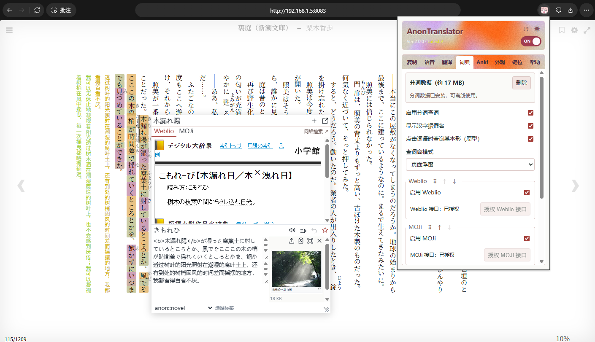

# AnonTranslator

网页小说阅读工具【**Chrome扩展** & **油猴脚本**】

支持按句子或段落复制、朗读和翻译；支持分词、查词和 Anki 制卡。均采用在线服务，目标是构建最灵活通用的学习环境。

首次安装点击 Chrome 工具栏图标或油猴菜单打开阅读工具。点击关闭 “×” 则关闭插件，使用时请保持Anon的“存活”，可移到窗边最小化。界面背景均自定义。



## 使用场景

- 在线阅读：很多在线网站都可以直接用
  - [小説家になろう](https://syosetu.com/)
  - [カクヨム](https://kakuyomu.jp/)
  - [青空文庫](https://www.aozora.gr.jp/)（因为是纯文本没html标签所以不能正常工作。但可以使用 [青空助手](https://aohelp.club/) 下载epub或者html看 | [作者B站视频](https://www.bilibili.com/video/BV1Xa4y1h7MW/)）
  - [本人自用书库](https://ebook.raindrop213.com/)

- 下载党：用浏览器打开EPUB格式电子书
  - 管理：[Calibre-web](https://github.com/janeczku/calibre-web) 自建书库（前提是你已经用 [Calibre](https://calibre-ebook.com/) 存好电子书了）
  - 下载：Z-Lib就不用多说了，那你也可能还知道安娜的档案和各种DLRaw网站
  - 购买：[bookwalker](https://bookwalker.jp/)、[Amazon](https://www.amazon.co.jp/kindle-dbs/storefront) 和 [Rakuten](https://books.rakuten.co.jp/e-book/) ，其中bookwalker解锁（DeDRM）稍难点，另外两个解锁相对简单一点
  - 阅读：这里放一个简单好用的epub阅读器 [ッツ Ebook Reader](https://reader.ttsu.app)


## 安装插件

首次安装后点击图标打开设置，功能默认关闭，请按需开启。以下任选一种方式安装，另外也可以从 [Releases](https://github.com/raindrop213/AnonTranslator/releases/latest) 下载进行手动安装。

- Chrome 扩展
  - 从 [Chrome 商店](https://chromewebstore.google.com/detail/anontranslator/echegehpmakkcfcadfjljpcallkhpldi) 安装扩展，点击 “添加至 Chrome”。
  - 点击图标打开设置。
  - （若将扩展设为“仅在特定网站生效”，需要手动点击对应的“授权…接口”按钮来授权）

- Tampermonkey 油猴脚本
  - 安装 [Tampermonkey](https://www.tampermonkey.net/)，在 Chrome 的扩展详情中开启“允许用户脚本”（[官方说明](https://www.tampermonkey.net/faq.php?locale=zh&q=Q209)）。
  - 从 [Greasy Fork](https://greasyfork.org/zh-CN/scripts/599752-anontranslator) 安装脚本。
  - 刷新页面，点击油猴图标，通过 “AnonTranslator > 设置” 打开设置面板。
  - （若使用其他地址服务时弹出跨域授权提示，选择“总是允许此域名”）


## 默认操作

| 操作 | 功能 |
| --- | --- |
| 左键文本 | 标记、复制、朗读、翻译句子 |
| 右键文本 | 标记、复制、朗读、翻译段落 |
| ↑ / 2 / Num 2 | 上一段 |
| ↓ / 1 / Num 1 | 下一段 |
| 5 / Num 5 | 上一句 |
| 4 / Num 4 | 下一句 |
| 3 / Num 0 | 重读当前选择 |
| 空格 | 按当前段落 / 句子模式开始或暂停自动阅读 |
| Esc | 清除所有效果 |

段落模式适合每段较短的轻小说，句子模式适合长段落的一般小说。

## 分词查词

首次使用时需下载 [kuromoji@0.1.2](https://cdn.jsdelivr.net/npm/kuromoji@0.1.2/dict/) 的分词数据，在设置的“词典”页顶部点击“安装”即可，安装完成后打开“启用分词查词”。选择句子或段落后即可分词，再点击词语打开查词窗。不需要分词查词的用户无需安装。

- 使用 [Kuromoji](https://github.com/takuyaa/kuromoji.js) 进行日语分词，按词性着色，可显示汉字振假名。
- 默认查询词语的基本形（原型），可在设置中关闭。
- 支持在线查词，可分别开关、调整顺序。关闭两个词典服务后仍可分词、着色和显示振假名。
- 查词窗支持“页面浮窗”和“独立窗口 / 底部面板”两种模式，对应在桌面端和移动端的使用。

分词引擎在首次使用时初始化，Chrome 后台休眠后再次使用可能需要重新初始化本地数据。IPADIC 数据用于分词、基本形和读音，释义仍由在线词典提供。

## Anki 制卡

### 首次使用

1. 安装桌面版 [Anki](https://apps.ankiweb.net/) 及其插件 [AnkiConnect](https://ankiweb.net/shared/info/2055492159)，重启 Anki 后保持运行。
2. 在本插件的“Anki”设置页打开“启用 Anki 制卡”，点击“测试连接”。
3. 设置卡组和标签，制卡时可切换。不存在的卡组会在发送卡片时创建。
4. 按需选择例句翻译、单词音频和例句音频服务。

点击分词后的词语，查词窗中会同时显示制卡区，带入查询词、平假名读音、所在例句及来源信息。可以修改读音、例句和译文，添加图片，选择卡组与标签，最后点击星形按钮添加到 Anki。

- **例句与释义**：按设置生成例句翻译，收录成功加载的词典结果；可自动用 `<b>` 标签标注例句中的所选词语。
- **音频**：单词和例句可分别选择是否生成音频，保存到 Anki 媒体库。Windows TTS 用于朗读，不作为制卡音频来源。
- **图片**：支持上传、从剪贴板读取和框选截图，碍于权限，还是建议使用 `Win + Shift + S` 或者其他截图工具在从剪切板读取。
- **布局**：制卡区可放在词典下方或右侧，中间分隔线可拖动调整比例。
- **重复词**：同一笔记模型中已有相同单词时，可选择“重复”新建、“覆盖”已有笔记或“放弃”。
- **撤回**：撤回按钮仅针对最后成功新建的一条笔记，不能连续撤回；覆盖已有笔记不支持撤回。

### 卡片模板

发送卡片时会自动创建模型并同步正面、背面和样式，也可在设置中“手动同步模型”。**模板更新会应用到同一模型的全部卡片**；需要不同样式时请使用不同的模型名称。

在“Anki → 卡片模板”中编辑正面、背面和样式，下方会即时预览效果。有当前制卡内容时优先使用它，没有时显示示例；修改制卡内容后可点预览左上角的刷新按钮重新读取。点击预览中的单词或例句，会使用对应的 Anki 音频服务播放；选择“不添加”时不播放。例句翻译可以全部关闭。模板修改自动保存，发送卡片时同步到 Anki。

| 字段 | 内容 |
| --- | --- |
| `Word` / `Reading` | 单词 / 平假名读音 |
| `Sentence` / `Translation` | 例句 / 例句翻译 |
| `WordAudio` / `SentenceAudio` | 单词音频 / 例句音频 |
| `Image` | 图片 |
| `DictionaryData` | 词典结果数据 |
| `SourceURL` / `SourceTitle` | 来源网址 / 页面标题 |

模板通过 `{{Word}}` 等字段占位符引用内容。使用已有模型时，首字段须为 `Word`，且包含上述全部字段；若提示模型字段不兼容，可换一个模型名称，由插件自动创建。

## AI 翻译

在“翻译 → AI 翻译”中填写接口地址、模型名称和 API Key，接口格式默认根据地址自动识别。Chrome 首次访问自定义接口需要点击“授权接口”；油猴由脚本管理器处理跨域授权。打开 AI 翻译开关后，选中文字即可显示译文，也可以在“Anki → 例句翻译”中单独选用 AI。

| 接口格式 | 完整地址示例 |
| --- | --- |
| OpenAI 兼容（GPT、DeepSeek 等） | `https://api.openai.com/v1/chat/completions` / `https://api.deepseek.com/chat/completions` |
| Claude | `https://api.anthropic.com/v1/messages` |
| Gemini | `https://generativelanguage.googleapis.com/v1beta/models/{model}:generateContent` |

三种格式均支持服务根地址：OpenAI 兼容接口补全 /chat/completions（OpenAI 官方根地址补全 /v1/chat/completions），Claude 补全 /v1/messages，Gemini 补全 /v1beta/models/模型名:generateContent。也支持 /v1 或 Gemini 的 /v1beta 基础地址；完整路径保持原样；Gemini 地址中的 `{model}` 会使用填写的模型名称替换。转发服务或本地模型也可填写自己的完整地址，不需要密钥的接口可将 API Key 留空。特殊中转地址无法识别时，可在“高级设置”中手动指定接口格式；这不会修改地址。

“高级设置”支持自定义英文提示词、请求头和请求参数。`{{text}}` 是原文，`{{from}}` / `{{to}}` 是源语言和目标语言的英文名称；自动识别时 `{{from}}` 为 `auto-detect`。旧版默认提示词会更新，自定义提示词会保留。

请求头与参数使用 JSON 对象，例如 `{"temperature":0.3}`、`{"reasoning_effort":"low"}`；嵌套对象会合并，数组或其他值会替换同名默认字段。显式填写的 `stream: true` 或 `stream: false` 优先于流式开关。

其他服务的 OpenAI 兼容接口也共用这一格式。基础地址以 `/v1`、`/v2`、`/v3` 等版本路径结尾时会补全 `/chat/completions`，包括 `/compatible-mode/v1`、`/api/paas/v4` 这样的路径。Mistral、Cohere 的官方根地址会补全各自的兼容路径。Azure 官方 `*.openai.azure.com` 地址自动使用 `api-key` 鉴权，支持完整部署地址及 `api-version` 查询参数；代理的特殊鉴权仍可在请求头中指定。

使用 Qwen MT 模型时，会按其接口要求发送原文，并根据所选语言生成 `translation_options`，也可在自定义参数中添加术语等选项。不同模型的流式模式按服务格式解析；这不包含 DashScope 原生接口、千帆 AK/SK 签名交换或 OCR 接口。

## 项目结构

```text
src/
  reader/       阅读操作、分词展示、查词窗、制卡区与截图
  services/     分词、词典、语音、翻译、Anki 与网络请求
  settings/     站点开关、设置页、玻璃样式与浮窗
  platform/     Chrome / 油猴适配、共享启动入口、后台与缓存
assets/         公用图标与一张界面预览
tests/          核心测试与一个双平台本地预览页
build.mjs       两个平台共用的构建脚本
package.json    版本号与构建命令
dist/
  extension/    Chrome 扩展
  tampermonkey/ AnonTranslator.user.js
```

两个平台共用一套功能代码，版本统一读取 `package.json`。

## 开发与打包

安装 [Node.js](https://nodejs.org/)，在项目文件夹中打开终端。第一次安装依赖，以后修改代码后只需构建：

```sh
npm install
npm run build
```

构建后生成 `dist/`，在 Chrome 的 `chrome://extensions/` 中打开“开发者模式”，点击“加载已解压的扩展程序”，选择 `dist/extension/`；油猴版安装 `dist/tampermonkey/AnonTranslator.user.js`。更新本地扩展后，重新加载扩展并刷新阅读页面。

运行自动化测试：

```sh
npm test
```

测试集中在 3 个文件：`site.test.mjs` 验证网站开关与生命周期；`core.test.mjs` 验证关键数据处理和服务行为；`build.test.mjs` 实际构建并检查双平台安装产物。不需要浏览器或在线服务。

界面预览只保留一页：运行 `npm run dev`（自动构建），打开 `http://127.0.0.1:8788/`，点击“载入本地版本”。页面运行实际 Chrome 内容脚本或油猴构建产物，以本地适配器代替浏览器/GM API。在线翻译、词典、语音及本地 Anki/VITS 需要安装后配置相应服务。
