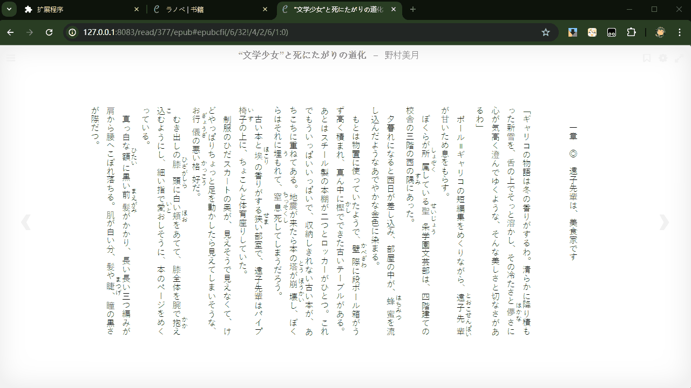

# AnonTranslator

用于浏览器阅读日语小说的文本复制、TTS与翻译工具。发布于 Chrome扩展 和 Tampermonkey油猴 两个平台。

**Chrome插件/扩展**


### **插件安装**
- Chrome扩展：[Chrome商店](https://chromewebstore.google.com/detail/anontranslator/echegehpmakkcfcadfjljpcallkhpldi)下载 或 [release](https://github.com/raindrop213/AnonTranslator/releases/latest)下载；

- Tampermonkey油猴：[Release](https://github.com/raindrop213/AnonTranslator/releases/latest) 下载 `.user.js` 文件后安装；

- ※ 首次使用请打开总开关（ON/OFF）。

### **使用场景**
- 在线阅读：很多在线网站都可以用
  - [小説家になろう](https://syosetu.com/)；
  - [カクヨム](https://kakuyomu.jp/)；
  - [青空文庫](https://www.aozora.gr.jp/)（因为是纯文本没html标签所以不能正常工作。但可以使用 [青空助手](https://aohelp.club/) 下载epub或者html看 | [作者B站视频](https://www.bilibili.com/video/BV1Xa4y1h7MW/)）；
  - [本人自用书库](https://ebook.raindrop213.com/)
- 下载党：EPUB / HTML 格式
  - 管理：[Calibre-web](https://github.com/janeczku/calibre-web) 自建书库（前提是你已经用 [Calibre](https://calibre-ebook.com/) 存好电子书了）
  - 下载：Z-Lib就不用多说了，那你也可能还知道安娜的档案和各种DLRaw网站；[小説図書館](https://yonde.itazuraneko.org/)
  - 购买：[bookwalker](https://bookwalker.jp/)、[Amazon](https://www.amazon.co.jp/kindle-dbs/storefront) 和 [Rakuten](https://books.rakuten.co.jp/e-book/) ，其中bookwalker解锁（DeDRM）稍难点，另外两个解锁相对简单一点
  - 阅读：这里放一个简单好用的epub阅读器 [ッツ Ebook Reader](https://reader.ttsu.app)

## 默认操作

| 操作 | 功能 |
| --- | --- |
| 左键点击段落 | 标记、复制、朗读、翻译段落 |
| 右键点击句子 | 标记、复制、朗读、翻译句子 |
| ↑ / 2 / Num 2 | 上一段 |
| ↓ / 1 / Num 1 | 下一段 |
| 5 / Num 5 | 上一句 |
| 4 / Num 4 | 下一句 |
| F1 / Num 0 | 重读当前段落 |
| 空格 | 按当前句子 / 段落开始或停止自动阅读 |
| Esc | 停止朗读与自动阅读 |

阅读有段落和句子两种模式：句子模式适合长段落一般小说，段落模式适合每段很短的轻小说，方便在相邻段落或句子之间跳转。

默认拾取的目标文本标签为 `p`、`h1`–`h6`，可在“复制”栏自定义“目标文本标签”，用逗号分隔，例如 `p,h1,li,div`。这个设置同时决定复制、朗读、翻译和段落导航的目标。句子可以跨多个嵌套的 span、em、b 和 ruby；ruby 保持整体，振假名不参与断句。段落中的交互元素会跳过句子包装，避免改变其行为。

[vitsTTS整合包](https://github.com/raindrop213/LunaTranslator-re/releases/tag/v0.0.3)：下载解压后打开 <kbd>start.bat</kbd> ，待地址出现后即可使用。（注：原项目来自 [vits-simple-api](https://github.com/Artrajz/vits-simple-api) 。该整合包里面包含所需的vits模型([vits-uma-genshin-honkai](https://huggingface.co/spaces/zomehwh/vits-uma-genshin-honkai))。

## 项目结构

```text
src/
  config/       默认设置
  core/         阅读、翻译、语音等共用逻辑
  platform/     Chrome / Tampermonkey 适配
  ui/           设置界面与样式
  entries/      平台启动入口
assets/img/     扩展图标
docs/           图片与改造记录
scripts/        构建、打包与接口诊断
tests/          接口、界面与五种阅读页模拟测试
dist/           自动生成的安装包，不提交 Git
```

两个平台共用一套核心代码。版本号统一读取 `package.json`；`dist/` 由构建生成，请勿手动编辑。

## 开发与打包

建议使用 Node.js 22，构建无需安装依赖：

```sh
npm run build      # 生成扩展目录和油猴脚本，在“dist”中
npm test           # 构建并验证接口与平台产物
```

- **Chrome**：在 `chrome://extensions` 开启开发者模式，加载 `dist/extension`。更新后重新构建并刷新扩展即可。
- **油猴**：在 Tampermonkey 中新建脚本，粘贴 `dist/tampermonkey/AnonTranslator.user.js` 的内容；通过油猴菜单打开“AnonTranslator 设置”。

首次使用请打开总开关（ON/OFF）。

## 发布与更新

发布只需三步，大小版本使用相同流程：

1. 修改 `package.json` 的 `version`，例如 `2.0.1`。
2. 提交标题写为相同版本的 `v2.0.1`，推送到 main。
3. Actions 自动测试、打包并创建 `v2.0.1` Release，再将产物提交到两个平台。

只检查本次推送最后一个提交的标题（第一行），必须严格为 `vX.X.X`，且与 `package.json` 一致；普通提交不发布，不一致则报错。无需手动创建 Git tag。重复发布已有版本会跳过，也可在 Actions → Release → Run workflow 手动发布当前版本。

- **油猴**：将 Release 中的 `.user.js` 完整代码提交到同一个 Greasy Fork 脚本页面，用户通过油猴获取更新。GitHub 不会自动同步到 Greasy Fork。
- **Chrome 手动安装版**：下载 Release 中的扩展 ZIP，覆盖原来的固定目录，在 `chrome://extensions` 重新加载，再刷新阅读网页。
- **Chrome 商店版**：向同一个商店条目上传新版 ZIP，审核发布后由 Chrome 自动更新。GitHub Release 不会自动提交到商店。

`dist/` 不提交 Git。每个 Release 只提供 `AnonTranslator-vX.X.X-extension.zip` 和 `AnonTranslator-vX.X.X.user.js`，由作者手动提交到两个平台。

设置读取 GitHub 最新正式 Release 的版本号，显示“当前为最新版本”或“建议更新vX.X.X”，仅作提示，不下载或安装更新。有新版时点击查看发布页，其余状态可点击重新检查；未发布、检查失败会单独显示。Chrome 限制网站访问时，可在提示处授权 GitHub 版本接口。两个平台的实际上线时间以作者提交和平台发布为准。

## 平台与权限

| 功能 | Chrome 扩展 | Tampermonkey |
| --- | --- | --- |
| 设置入口 | 扩展弹窗 | 脚本菜单 |
| 设置存储 | 浏览器本地存储 | 脚本管理器存储 |
| 跨域请求 | 扩展后台请求 | GM_xmlhttpRequest |

两个平台的设置独立。本地 HTML 需要允许访问文件 URL。Chrome 若设置为“仅在特定网站生效”，还需在对应服务框中授权相关接口权限。授权不能解决断网、代理故障或服务端限流。

## 额外验证

浏览器回归需要 Playwright 和已安装的 Chrome：

```sh
npm install --no-save --package-lock=false playwright
npm run test:browser
```

也可设置 `PLAYWRIGHT_MODULE` 指向已有安装目录。测试使用模拟接口，覆盖界面与 TTsu、Bibi、Calibre-Web、Kakuyomu、Syosetu 五种页面结构；截图保存在 `test-results/`，不提交 Git。范围与限制见 [测试说明](tests/README.md)。

以下诊断脚本会向对应服务发送固定测试文本：

```sh
node scripts/probe-services.mjs   # Google / 有道翻译
node scripts/probe-vits.mjs       # VITS 声音列表与合成
node scripts/probe-huoshan.mjs    # 火山语音合成
```

原作者：raindrop213；MIT License。

### **开发计划(可能)**
- 词典（moji、weblio）
- 日本語形態素解析（MeCab）
- 联动 Anki

---

